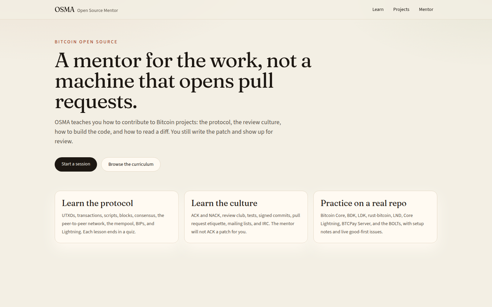
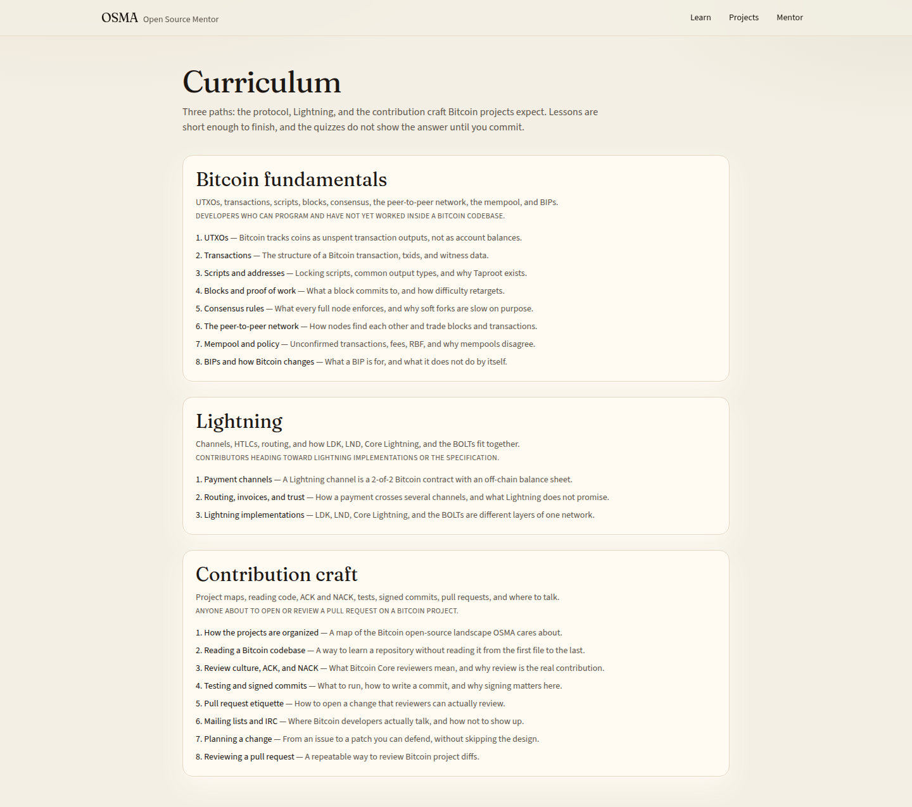
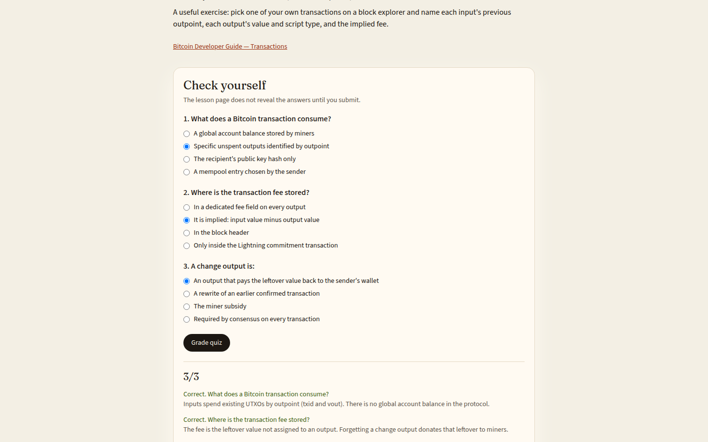
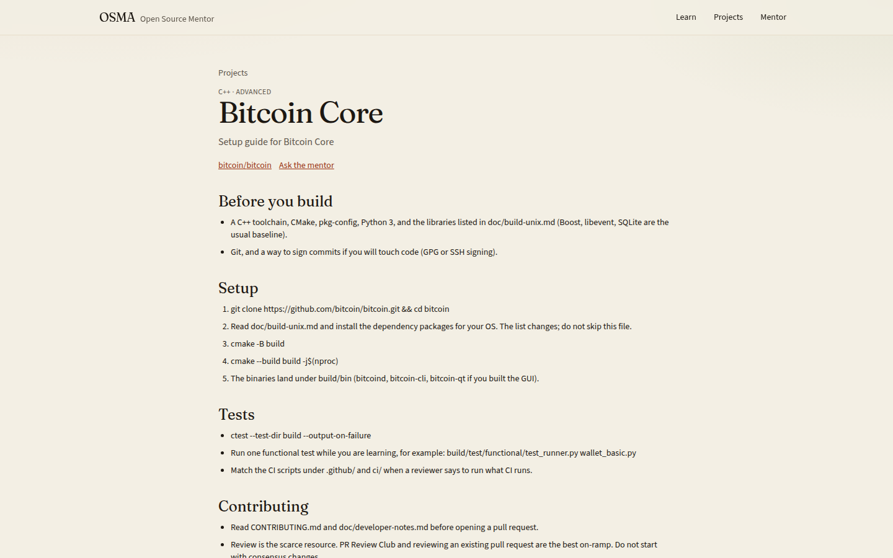
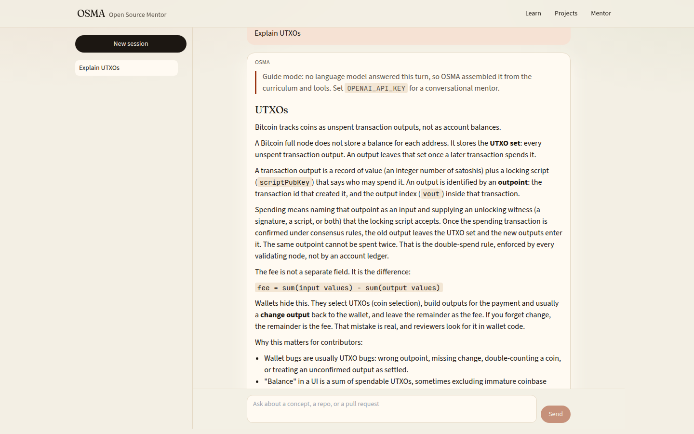

# OSMA

OSMA (Open Source Mentor AI) is a local-first mentor for people who want to contribute to Bitcoin open-source projects. It runs on your machine. Guide mode is the default: with an empty `OPENAI_API_KEY`, the curriculum, project guides, and GitHub tools work and no language model is called.

A conversational mentor is optional. The default endpoint is local Ollama (`llama3.2` at `http://127.0.0.1:11434/v1`). Cloud OpenAI (`https://api.openai.com/v1`) works only if you set that base URL, a cloud model name, and a real key yourself.

OSMA teaches the protocol and the review culture, then helps you set up a repository, find a first issue, plan a change, and review a pull request. It does not open pull requests for you, and it will not ACK code you have not read.

## What you can ask

- Explain a concept: UTXOs, transactions, scripts, blocks, consensus, the peer-to-peer network, the mempool, BIPs, Lightning, ACK/NACK, signed commits, mailing lists, IRC.
- Walk a learning path. Each lesson has a quiz. Answers stay hidden until you submit.
- Show a setup guide for Bitcoin Core, libsecp256k1, rust-bitcoin, rust-miniscript, BDK, LDK, LND, Core Lightning, BTCPay Server, or the Lightning BOLTs.
- Fetch open good-first-issue style tickets from GitHub.
- Explain a repository or a file.
- Plan a contribution from a goal or an issue number.
- Review a pull request URL or a diff, using project review conventions. OSMA will not say ACK for you.

With a non-empty `OPENAI_API_KEY`, a tool-calling model writes the reply. The default server is Ollama on loopback. Set `OPENAI_BASE_URL=https://api.openai.com/v1` and a cloud model only if you want that traffic to leave the machine. Without a key, **guide mode** still calls the same tools and assembles the answer from the curriculum and GitHub. That is enough to learn and to try the app. Details of what stays local are in [docs/PRIVACY.md](docs/PRIVACY.md).

## Roadmap

v0.1.0 is prepared and not tagged. There is no telemetry, so this README does not report installs, learners, or pull requests. Numbers in the table are **targets**. The milestone plan, including what is already in the tree, is in [docs/ROADMAP.md](docs/ROADMAP.md). Release notes are in [docs/releases/v0.1.0.md](docs/releases/v0.1.0.md).

### In the v0.1.0 candidate

- Guide mode when `OPENAI_API_KEY` is empty, with local Ollama as the default endpoint if you later opt into a model
- Three English paths (Bitcoin fundamentals, Lightning, contribution craft) and quizzes graded on the local API
- Setup and review notes for ten Bitcoin and Lightning projects
- GitHub lookups for issues, files, and pull requests. OSMA does not open pull requests
- `make start` and `make up`, plus GitHub Actions for the API and the web app

### Targets after v0.1.0

| Target | What “done” means |
| --- | --- |
| Developers onboarded | **Target:** 40 people finish one learning path in a pilot. No pilot has been run. |
| Pull requests mentored | **Target:** 15 pull requests that learners open themselves on Bitcoin or freedom-tech repositories. OSMA will not open them. |
| Local installs | **Target:** 100 installs that people choose to report. The app will not count them. |
| Languages | **Target:** English plus 3 languages reviewed by native speakers, including African languages. v0.1.0 is English only. |

## Architecture

```
Browser
  └─ Next.js (apps/web)          chat, curriculum, project pages
       └─ same-origin proxy      only /health and /api/v1/*
            └─ FastAPI (services/agent-api)
                 ├─ mentor loop  OpenAI-compatible /chat/completions
                 │               default: local Ollama, unused until a key is set
                 ├─ tools        curriculum, projects, GitHub, review
                 └─ SQLite       conversations only
```

`OPENAI_API_KEY` and `GITHUB_TOKEN` stay in the environment. They are not stored in SQLite, not written into tool results, and there is no job queue that could hold them. Logs pass through a redaction filter. When a key is set, it is sent as a bearer header to `OPENAI_BASE_URL`. When a GitHub token is set, it is sent as a bearer header to `api.github.com`. Public GitHub lookups are outbound even with no token. See [docs/PRIVACY.md](docs/PRIVACY.md).

The web proxy only forwards to `localhost`, `127.0.0.1`, or the Compose hostname `agent-api`. Redirects from GitHub and from the LLM endpoint are not followed.

## Run locally without Docker

Requirements: Python 3.11+, Node.js 22, and git. Ollama is optional.

```bash
make start
```

`make start` is the one-command local startup. It copies `.env.example` to `.env` when `.env` is missing, installs dependencies when they are missing, and starts the API and the web app. Guide mode works with the empty `OPENAI_API_KEY` from `.env.example`. Nothing else is required to use the curriculum and the tools.

- Web: http://127.0.0.1:3000
- API: http://127.0.0.1:8000 (interactive docs at http://127.0.0.1:8000/docs)

Ctrl-C stops both processes. `make setup` installs without starting. `make dev` starts both when dependencies are already installed. `make api-dev` and `make web-dev` run one process each.

The API reads `.env` from the repository root.

For a local conversational model, install Ollama and pull the default model, then set a placeholder key and run `make start` again:

```bash
ollama pull llama3.2
# In .env, set OPENAI_API_KEY to any non-empty placeholder.
# OPENAI_BASE_URL and OPENAI_MODEL already default to
# http://127.0.0.1:11434/v1 and llama3.2.
```

Ollama does not check the key. OSMA treats any non-empty key as "call the model" and an empty key as guide mode. `make start` runs on the host, so `127.0.0.1:11434` is Ollama on this computer.

Cloud OpenAI is opt-in. In `.env`, set `OPENAI_BASE_URL=https://api.openai.com/v1`, set `OPENAI_MODEL` to a cloud model such as `gpt-4o-mini`, and set `OPENAI_API_KEY` to a real key. Leave `GITHUB_TOKEN` empty unless you want a higher GitHub API rate limit. Do not commit `.env`.

Check the install:

```bash
make check
```

## Workspace

`/workspace` is a small IDE for two catalog repositories: BDK and rust-bitcoin. Choose one and OSMA runs a shallow `git clone` into `~/.osma/workspaces` (or `OSMA_WORKSPACE_ROOT`), which is outside this source tree. The clone sets `core.hooksPath` to `/dev/null`, so repository hooks do not run. The page shows the file tree, an editor, that project's contributing notes, and its review and test checklist.

Guide mode still needs no API key. Ask it to explain the open file, or search the clone. It will not change a file by itself.

A suggested edit needs a local model. Ollama ignores the key, so any non-empty `OPENAI_API_KEY` turns the model on. For the IDE, a small open code model is a better fit than the default chat model:

```bash
ollama pull qwen2.5-coder:1.5b
```

Set `OPENAI_MODEL=qwen2.5-coder:1.5b` in `.env` and leave `OPENAI_BASE_URL` on `http://127.0.0.1:11434/v1`. `qwen2.5-coder:3b` is the same family if the machine has the memory. The model may propose a diff. Nothing is written until you accept it, and the write stays in that local file.

There is no terminal. OSMA does not run tests, `git commit`, `git push`, or open a pull request. Bitcoin Core and the other catalog projects stay on the learning and project pages; cloning them is not part of this IDE yet.

`make start` is the path that has git on the host. Compose installs git in the API image and stores clones in the `osma-workspaces` volume.

## Walkthrough

These frames are guide mode on a local machine: empty `OPENAI_API_KEY`, no cloud model. The curriculum and the project page do not need a key. The mentor reply is assembled from the local notes.











`make check` runs API lint (`ruff check app tests`), API tests (`pytest`), web lint, web tests, and the web production build. GitHub Actions runs the same checks on pushes to `main` and on pull requests targeting `main`.

## Run with Docker

Requirements: Docker with Compose v2.

```bash
make up
```

`make up` is the one-command Compose startup. It copies `.env.example` to `.env` when `.env` is missing, then runs `docker compose up --build`. The site is http://127.0.0.1:3000 and the API is http://127.0.0.1:8000. Ports are bound to loopback. SQLite lives in the `osma-data` volume. With an empty key, the container stays in guide mode and does not call a model.

Compose's default `OPENAI_BASE_URL` is `http://127.0.0.1:11434/v1`. Inside the API container that address is the container itself, not Ollama on the host. Leave the key empty for guide mode.

To use Ollama on the host from Compose, install Ollama, run `ollama pull llama3.2`, and set these in `.env` before `make up`:

```bash
OPENAI_API_KEY=ollama
OPENAI_BASE_URL=http://host.docker.internal:11434/v1
```

The key can be any non-empty placeholder. Ollama does not check it. Compose maps `host.docker.internal` to the host. `OPENAI_MODEL` already defaults to `llama3.2`. `make start` remains the path that talks to Ollama at `127.0.0.1:11434` without Docker.

To opt into cloud OpenAI from Compose, set `OPENAI_BASE_URL`, `OPENAI_MODEL`, and `OPENAI_API_KEY` in `.env` as above.

```bash
make down
```

## Configuration

| Variable | Purpose |
| --- | --- |
| `OPENAI_API_KEY` | Bearer token for the chat API. Empty enables guide mode and no model is called. Any non-empty value calls `OPENAI_BASE_URL`. Ollama ignores the value. |
| `OPENAI_BASE_URL` | OpenAI-compatible base. Default `http://127.0.0.1:11434/v1` (Ollama). `http://` is allowed only for localhost. Cloud OpenAI is opt-in: `https://api.openai.com/v1`. |
| `OPENAI_MODEL` | Model name sent as `model`. Default `llama3.2`. Set a cloud model name only when you opt into a cloud base URL. |
| `GITHUB_TOKEN` | Optional. Env only. Public read is enough. Without it, GitHub's anonymous rate limit applies. Lookups are still outbound. |
| `DATABASE_URL` | Default SQLite file `sqlite:///./data/osma.db` under `services/agent-api`. |
| `AGENT_API_URL` | Where the Next.js server proxies. Default `http://127.0.0.1:8000`. |

There is one env example file: `.env.example`. Do not commit `.env`.

## Tests

API tests live in `services/agent-api/tests`. They cover the curriculum, project guides, GitHub tools (with a fake client and a mock HTTP transport), the tool-calling loop, guide mode, validation, settings defaults, and the chat rate limit. The LLM is scripted in tests, so no key is required. The test process pins its own base URL so the suite does not dial a local daemon. Product defaults are asserted with those variables unset.

The web package tests the proxy allowlist (`npm test` in `apps/web`).

## Limitations

- No accounts. Anyone who can open the port can read the conversations in that SQLite file. Keep it on localhost. See [SECURITY.md](SECURITY.md).
- Guide mode routes by phrases and then calls tools. It is not a free-form tutor. A non-empty key, pointed at Ollama by default, enables that.
- OSMA does not fork repositories, push commits, or open pull requests.
- Setup steps are a map, not a mirror of upstream docs. When they disagree, follow the repository.
- Good-first-issue search depends on the labels projects actually use. Bitcoin Core often has few of them. Reviewing an existing pull request is the better first contribution, and the mentor says so.
- Rate limits are in-memory and per process.
- The web proxy will not forward to an arbitrary host. Local and Compose hostnames only.
- From inside Docker Compose, `127.0.0.1:11434` is not Ollama on the host. Set `OPENAI_BASE_URL=http://host.docker.internal:11434/v1` to use host Ollama, or use `make start`.

## Project docs

- [Roadmap](docs/ROADMAP.md) — shipped scope and labelled targets
- [Changelog](CHANGELOG.md) — v0.1.0 notes, tag not created
- [v0.1.0 release notes](docs/releases/v0.1.0.md)
- [Contributing](CONTRIBUTING.md) — local setup, tests, and how to propose curriculum or catalog changes
- [Security](SECURITY.md) — private vulnerability reports, no accounts, localhost database and API
- [Privacy](docs/PRIVACY.md) — what stays on the machine, and what leaves if you opt in
- [License](LICENSE) — MIT, Copyright (c) 2026 Mwila Alfred Walima

## License

[MIT](LICENSE). Copyright (c) 2026 Mwila Alfred Walima.
